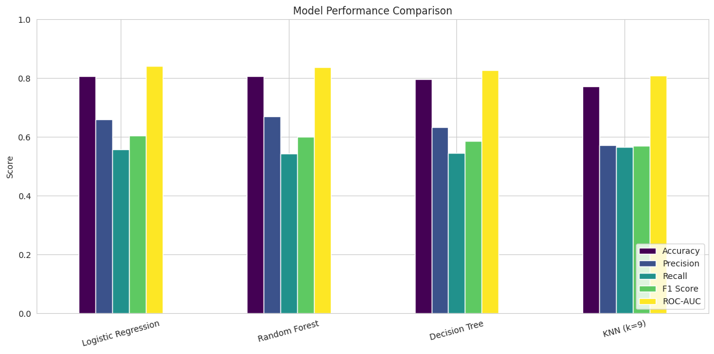
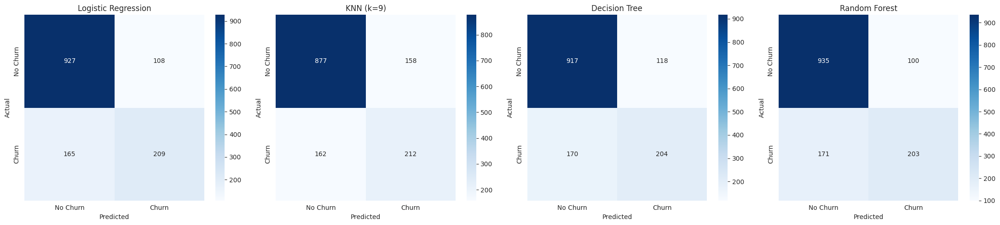
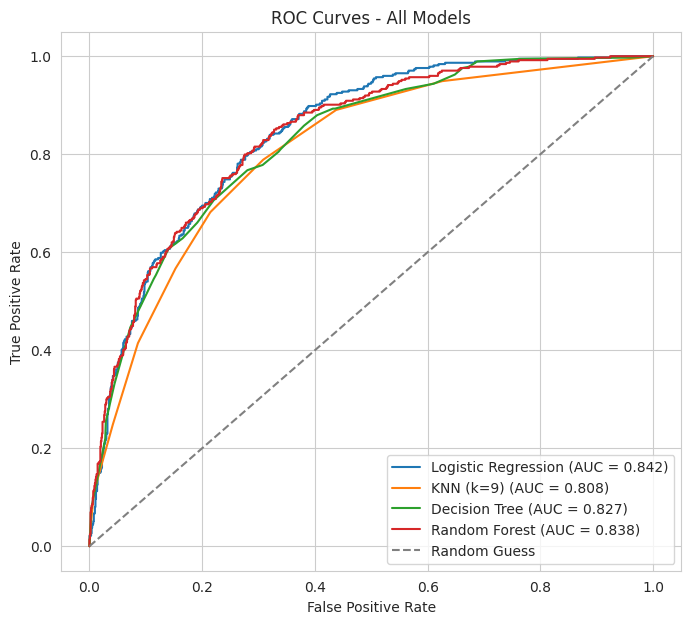

# Customer Churn Prediction using Machine Learning

A Machine Learning project to predict customer churn using the Telco Customer Churn dataset. This project explores customer behavior, performs data preprocessing, trains multiple classification models, and compares their performance using different evaluation metrics.

## Project Overview

Customer churn occurs when customers stop using a company's products or services. For telecommunications companies, identifying customers who are likely to leave is important for improving customer retention and reducing revenue loss.

In this project, I developed and evaluated four Machine Learning classification models to predict whether a customer is likely to churn.

The project focuses on data analysis, preprocessing, model implementation, hyperparameter tuning, and model evaluation.

## Objectives

- Perform Exploratory Data Analysis (EDA) to understand customer behavior.
- Clean and preprocess the dataset.
- Handle missing values and encode categorical features.
- Apply feature scaling where required.
- Train and compare multiple classification models.
- Tune model hyperparameters.
- Evaluate model performance using classification metrics.
- Identify important factors associated with customer churn.

## Dataset

**Dataset:** Telco Customer Churn Dataset

**Source:** [Kaggle – Telco Customer Churn](https://www.kaggle.com/datasets/blastchar/telco-customer-churn)

The dataset contains 7,043 customer records and 21 columns, including customer information, services, contract details, payment methods, monthly charges, total charges, and churn status.

**Target Variable:**
- `0` – Customer did not churn
- `1` – Customer churned

### Churn Distribution

- No Churn: 5,174 customers (73.46%)
- Churn: 1,869 customers (26.54%)

## Technologies Used

- Python
- Pandas
- NumPy
- Matplotlib
- Seaborn
- Scikit-learn
- Jupyter Notebook / Google Colab

## Project Structure

```text
customer-churn-prediction/
│
├── data/
│   └── WA_Fn-UseC_-Telco-Customer-Churn.csv
│
├── images/
│   ├── model_comparison.png
│   ├── confusion_matrix.png
│   └── roc_curves.png
│
├── customer_churn_prediction.ipynb
├── README.md
├── requirements.txt
└── .gitignore
```

## Project Workflow

### 1. Exploratory Data Analysis (EDA)

- Explored dataset structure, data types, and statistical summaries.
- Checked missing values and duplicate records.
- Analyzed the distribution of churn and non-churn customers.
- Visualized relationships between customer features and churn.

### 2. Data Cleaning and Preprocessing

- Converted `TotalCharges` into numeric values.
- Handled 11 missing values in `TotalCharges` by filling them with 0, corresponding to customers with zero tenure.
- Removed the `customerID` column because it is an identifier rather than a predictive feature.
- Encoded the target variable.
- Applied Label Encoding to binary categorical features.
- Applied One-Hot Encoding to multi-category features.

### 3. Train-Test Split and Feature Scaling

- Training data: 80%
- Testing data: 20%
- Random state: 42
- Used stratified splitting to maintain the churn distribution.
- Applied StandardScaler to numerical features.

### 4. Model Implementation

Four classification algorithms were implemented:

| Model | Implementation |
|---|---|
| Logistic Regression | Binary classification |
| K-Nearest Neighbors (KNN) | Tested K = 3, 5, 7, 9 |
| Decision Tree | Tuned max_depth and min_samples_leaf |
| Random Forest | Tuned n_estimators, max_depth, and max_features |

### 5. Model Evaluation

The models were evaluated using:

- Accuracy
- Precision
- Recall
- F1 Score
- ROC-AUC
- Confusion Matrix
- ROC Curve

## Model Performance Comparison

The following table shows the actual evaluation results from the notebook.

| Model | Accuracy | Precision | Recall | F1 Score | ROC-AUC |
|---|---:|---:|---:|---:|---:|
| Logistic Regression | 0.8062 | 0.6593 | 0.5588 | **0.6049** | **0.8422** |
| Random Forest | **0.8077** | **0.6700** | 0.5428 | 0.5997 | 0.8384 |
| Decision Tree | 0.7956 | 0.6335 | 0.5455 | 0.5862 | 0.8268 |
| KNN (k=9) | 0.7729 | 0.5730 | **0.5668** | 0.5699 | 0.8079 |

### Model Comparison Visualization



### Key Observations

- Logistic Regression achieved the highest ROC-AUC (0.8422) and F1 Score (0.6049).
- Random Forest achieved the highest Accuracy (0.8077) and Precision (0.6700).
- KNN achieved the highest Recall (0.5668), although its overall performance was lower.
- Decision Tree provided a relatively interpretable model but performed below Logistic Regression and Random Forest on the main evaluation metrics.

Based on these results, Logistic Regression provides the strongest balance of F1 Score and ROC-AUC, while Random Forest offers slightly higher Accuracy and Precision.

## Confusion Matrix

A confusion matrix helps understand how correctly each model identifies churn and non-churn customers.

| Model | TN | FP | FN | TP |
|---|---:|---:|---:|---:|
| Logistic Regression | 927 | 108 | 165 | 209 |
| KNN (k=9) | 877 | 158 | 162 | 212 |
| Decision Tree | 917 | 118 | 170 | 204 |
| Random Forest | 935 | 100 | 171 | 203 |

Where:

- **True Positive (TP):** Correctly predicted churn customers.
- **True Negative (TN):** Correctly predicted non-churn customers.
- **False Positive (FP):** Predicted churn, but the customer did not churn.
- **False Negative (FN):** Predicted non-churn, but the customer actually churned.



In this business problem, False Negatives are particularly important because they represent customers who may leave without receiving a retention offer.

## ROC Curves

ROC curves illustrate the relationship between the True Positive Rate and False Positive Rate at different classification thresholds.

A higher ROC-AUC generally indicates better ability to distinguish between churn and non-churn customers.



The Logistic Regression model achieved the highest ROC-AUC of 0.8422 in this experiment.

## Key Business Insights

The exploratory analysis and feature importance results highlighted several factors associated with customer churn:

- **Contract Type:** Customers with month-to-month contracts showed higher churn rates.
- **Tenure:** Newer customers were more likely to churn than long-term customers.
- **Monthly Charges:** Customers with higher monthly charges showed higher churn rates.
- **Internet Services:** Customers without additional services such as OnlineSecurity and TechSupport showed higher churn rates.
- **Payment Method:** Customers using electronic checks showed higher churn rates than those using automatic payment methods.

These findings can help telecom companies identify customers who may need additional support, better service options, or targeted retention offers.

## Model Recommendation

Based on the actual evaluation results:

- **Logistic Regression:** A strong choice when ROC-AUC, F1 Score, and model simplicity are important.
- **Random Forest:** A suitable alternative when Accuracy, Precision, and feature importance analysis are priorities.

For this experiment, Logistic Regression achieved the highest ROC-AUC and F1 Score. Random Forest achieved the highest Accuracy and Precision.

The final model choice should depend on the business objective, particularly the cost of missing potential churn customers versus the cost of unnecessary retention offers.

## Limitations and Future Improvements

### Limitations

- The dataset represents a static snapshot of customer information.
- The dataset has class imbalance, with approximately 27% churn.
- The default classification threshold of 0.5 may not be optimal for business requirements.
- Customer support interactions and sentiment data are not included.
- Hyperparameter tuning uses a limited search rather than full cross-validation.

### Future Improvements

- Apply K-Fold Cross-Validation.
- Experiment with XGBoost, LightGBM, and CatBoost.
- Perform classification threshold tuning.
- Use SHAP for model explainability.
- Include customer usage patterns and support interaction data.
- Explore strategies to improve churn-class recall.

## Conclusion

This project helped me understand how Machine Learning can be applied to a practical business problem.

By exploring customer data and comparing four classification algorithms, I learned how data preprocessing, feature scaling, hyperparameter tuning, and model evaluation affect prediction performance.

The results showed that Logistic Regression and Random Forest were the strongest models in this experiment, with different strengths across evaluation metrics.


---

*This project was developed as part of my Machine Learning learning journey.*
